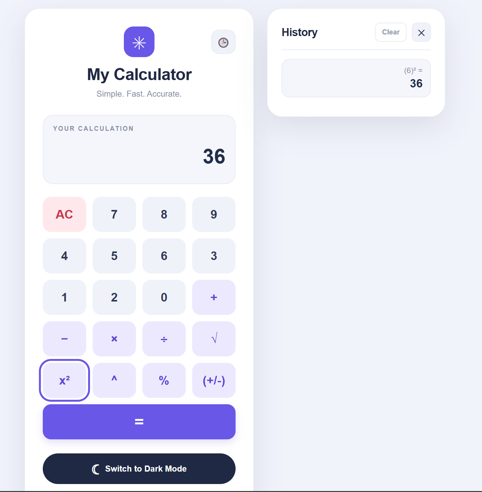
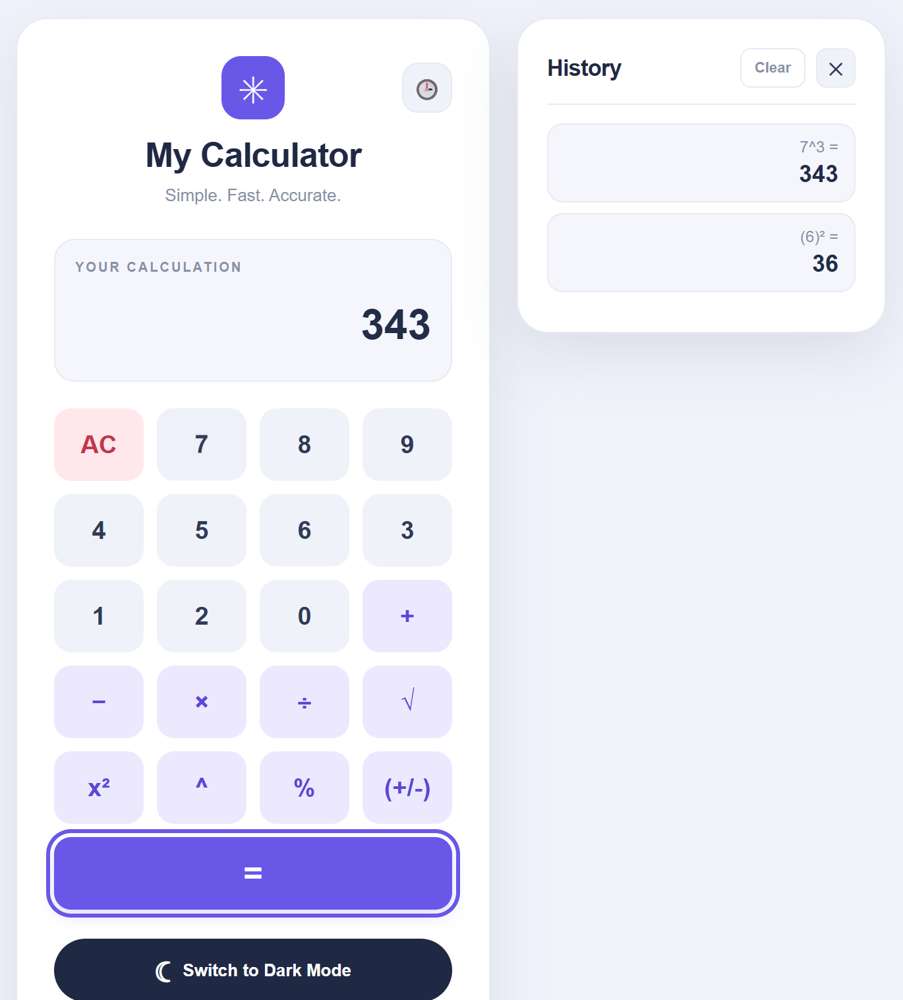
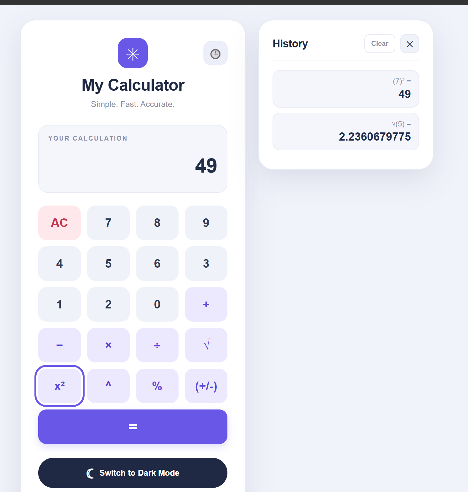
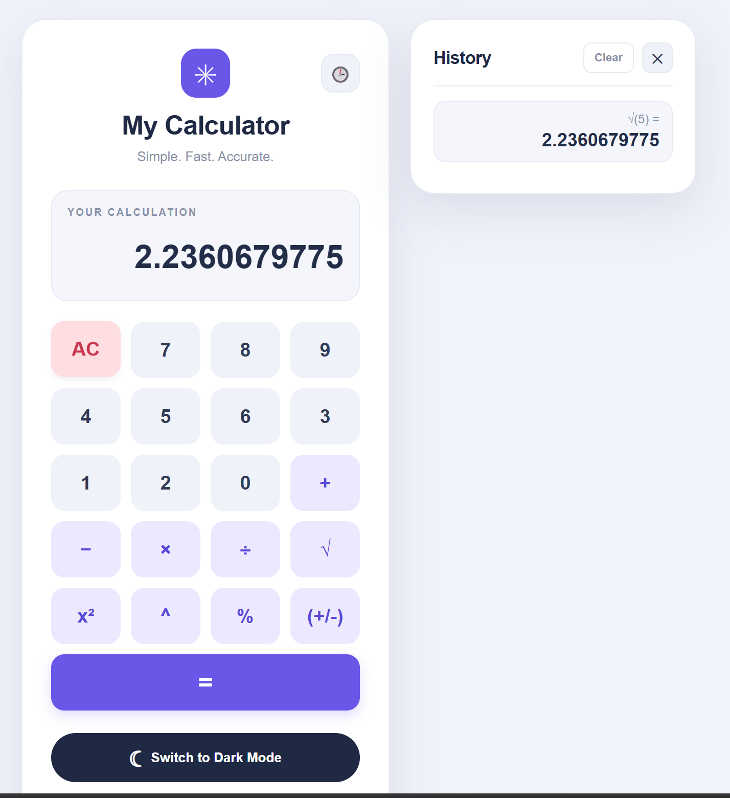
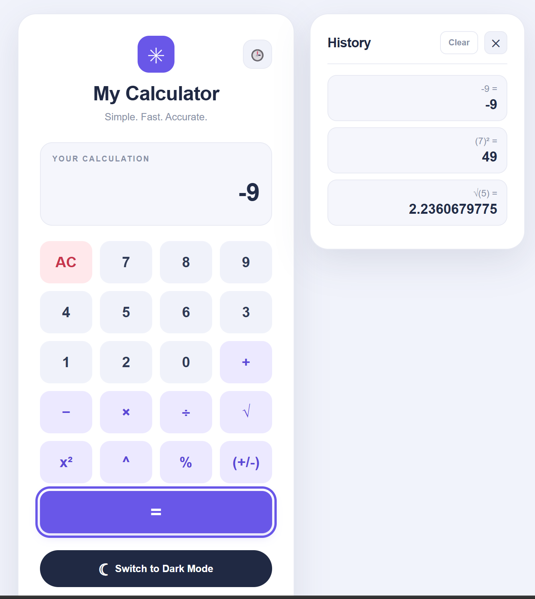
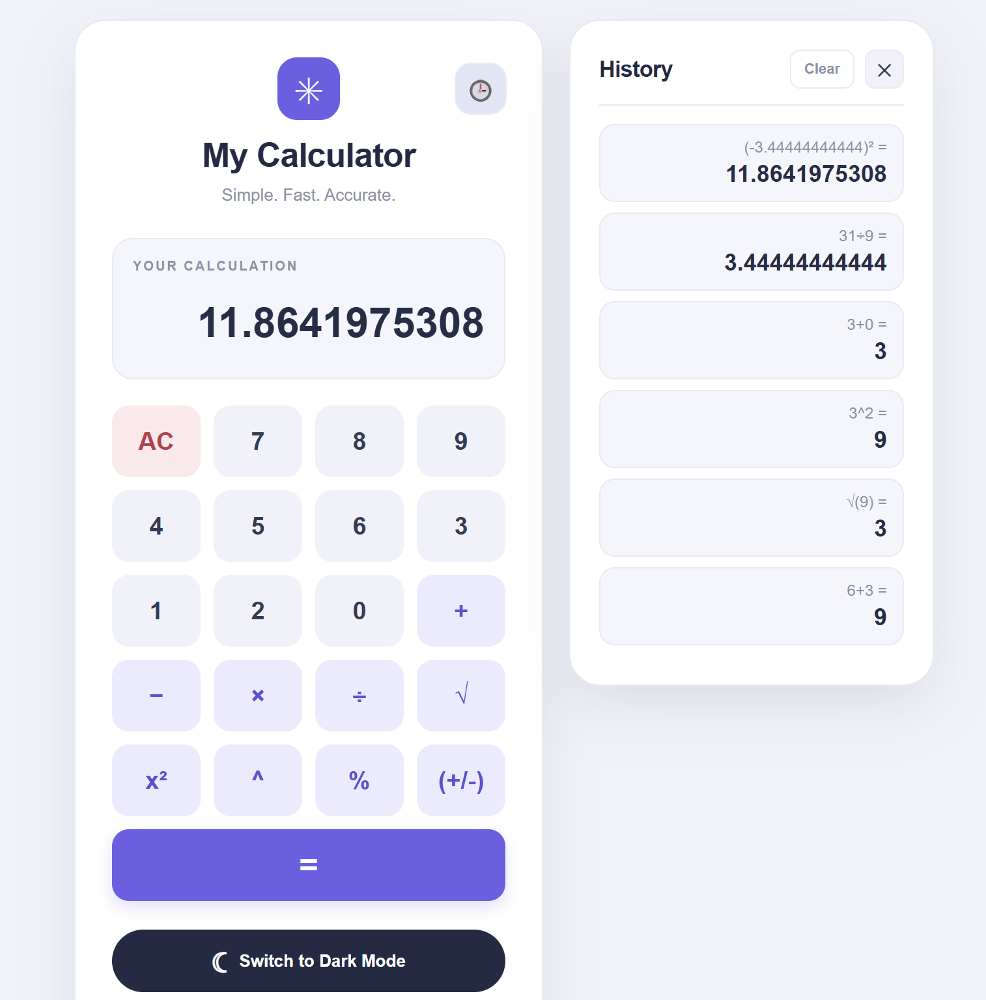
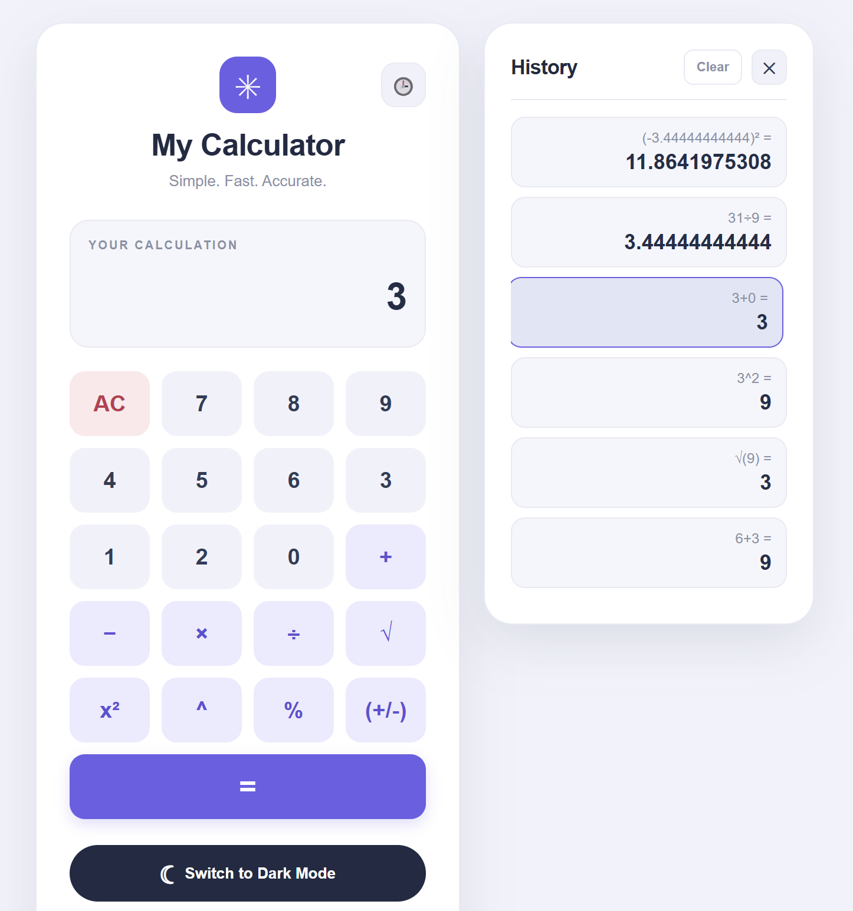
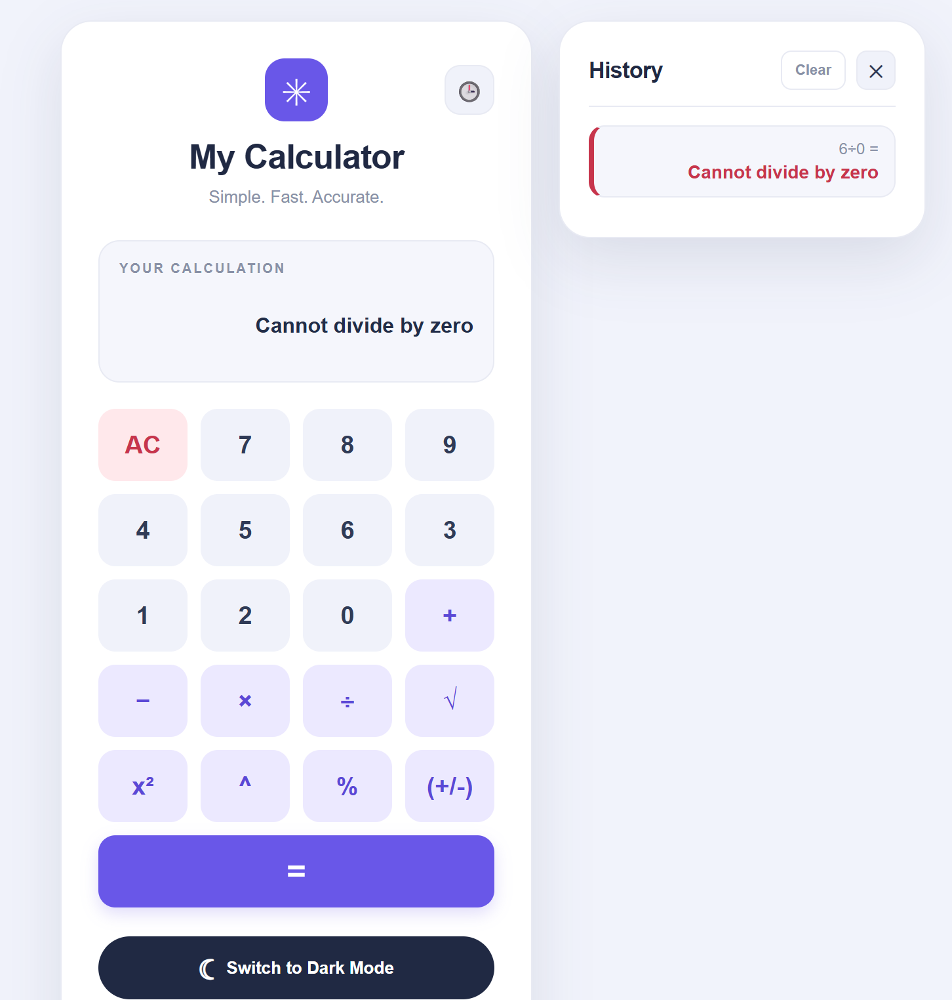

# My Calculator

A simple calculator built using HTML, CSS, and JavaScript.

## Features

- Addition
- Subtraction
- Multiplication
- Division
- Percentage - Converts display value into decimal percentages
- Sign toggle - Changes a positive number to a negative number and vice versa.
- Square root (√) - Takes square root of a number, shows error message if number is negative
- Square (x²) - Squares the display number
- Power (^) - Take the display number and raise it to the power of the number after the ^ sign
- Error handling (Division by zero, negative square roots) - Shows clear and readable error messages after an invalid operation has been performed.
- Calculation history panel (view, recall, and clear history) - Keeps track of previous operations, results, and error inputs (e.g., division by zero, invalid expressions, negative square roots). Can click on a previous result or error to recall it. The entire history log can be cleared too.
- Clear the display
- Light and Dark mode toggle

## Technologies Used

- HTML
- CSS
- JavaScript

## How to Run

Open the index.html file in a web browser.

## Screenshots

### Squaring and Exponent Functionality

### Square & Square Root Functionality

### Negative Numbers

### History Log & Recalling Results

### Error Handling

